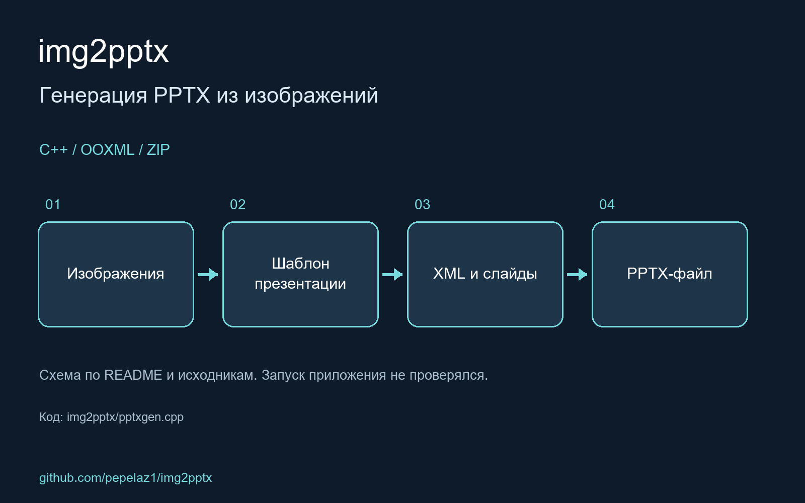

C++ library for creation pptx documents without need for MS PowerPoint to be installed

<!-- portfolio-visual:start -->
## Схема работы

Схема подготовлена по README и исходному коду. Запуск приложения не проверялся. В pptxgen.cpp имеются незаполненные методы.
<!-- portfolio-visual:end -->
